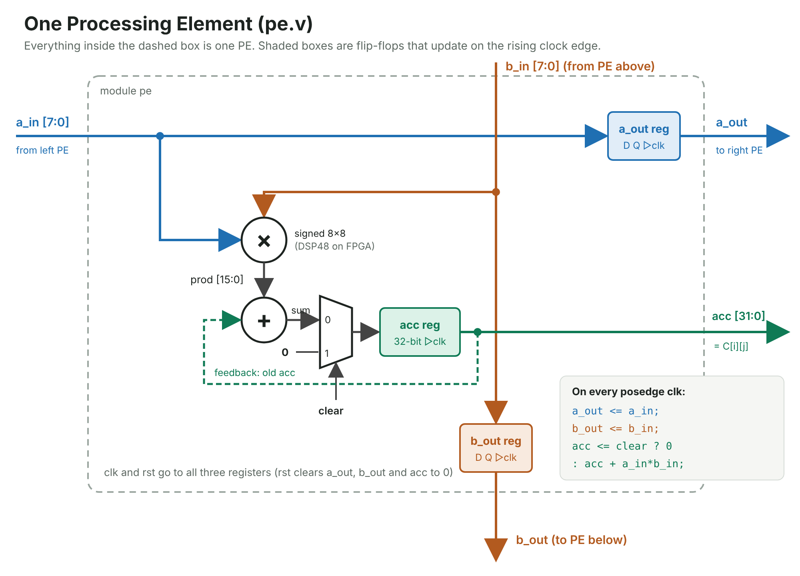
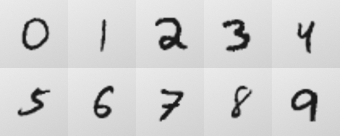

# 4×4 INT8 Systolic-Array Accelerator on a Basys3 FPGA

A matrix-multiply accelerator written from scratch in Verilog: a 4×4 output-stationary systolic array of INT8 multiply-accumulate units. It is wrapped as an AXI4-Lite peripheral, verified bit-exact against a NumPy golden model, and runs on a Digilent Basys3 (Artix-7). The board also runs an INT8 neural network that recognises handwritten digits, including digits from photos.

| | |
| --- | --- |
| Array | 4×4 PEs, signed INT8 inputs, 32-bit accumulators, output-stationary (parameterised: 8×8 also verified) |
| Latency | 11 clocks per 4×4×4 multiply (3N−1), measured by an on-chip cycle counter |
| FPGA | Basys3, xc7a35tcpg236-1, Vivado 2022.1 |
| Resources | **16 DSP48E1** (one per PE), 511 LUT, 986 FF, 0 BRAM |
| Fmax | **163 MHz** (WNS +3.866 ns at a 100 MHz constraint); 125 → 173 MHz through timing fixes |
| Peak compute | 16 MAC/clock ≈ 2.6 GMAC/s at 163 MHz |
| Verification | 1000 directed + random tests, 16,000 results bit-exact vs NumPy, 0 AXI protocol violations |
| Neural network | MNIST MLP 196→32→10, INT8: **97.00%** (float32: 97.03%), bit-exact with Python |

## Architecture

```
 PC (Python) --USB-UART 115200--> uart_rx -> uart_axil_bridge -> axil_master
                                                                    | AXI4-Lite
                                 axil_systolic  (register map, SLVERR/DECERR, packed writes)
                                    |
                                 systolic_top   (A/B buffers, FSM: IDLE-CLEAR-FEED-DRAIN-DONE, cycle counter)
                                    |
                                 systolic_core  (skew shift registers + 4x4 array of PEs)
                                    |
                                 pe             (acc += a*b on a DSP48, pass a right and b down)
```



### Register map (AXI4-Lite)

| Address | Register | Access | Meaning |
| --- | --- | --- | --- |
| 0x000 | CTRL | W | bit0 start, bit1 accumulate (C += A×B, used for tiling) |
| 0x004 | STATUS | R | bit0 busy, bit1 done |
| 0x008 | CYCLES | R | clocks taken by the last run |
| 0x00C | ID | R | 0x5A000408 (N=4, 8-bit) |
| 0x100 + 4w / 0x200 + 4w | A / B packed | W | 4 INT8 values per write (WSTRB honoured) |
| 0x400 + 4(iN+j) | A[i][j] | W | one INT8 per write |
| 0x800 + 4(iN+j) | B[i][j] | W | one INT8 per write |
| 0xC00 + 4(iN+j) | C[i][j] | R | signed 32-bit result |

## Results

### Timing closure (Vivado 2022.1)

| Version | DSP | LUT | FF | WNS | Fmax |
| --- | --- | --- | --- | --- | --- |
| Default synthesis | 0 | 2012 | 1411 | — | — |
| `use_dsp` on the PE | 16 | 549 | 771 | +1.986 ns | 125 MHz |
| Registered lookahead feed into the DSPs | 16 | | | +3.142 ns | 146 MHz |
| Registered, replicated reset (fanout 714 → ≤50) | 16 | | | +4.233 ns | 173 MHz |
| + packed AXI writes (final design) | 16 | 511 | 986 | +3.866 ns | 163 MHz |

### Running a neural network on it

Large layers are tiled onto the 4×4 array. K is split into chunks that are summed in the PE accumulators (accumulate mode), so one image needs 104 array runs. Requantization is integer-only (multiply by 40422, shift right by 24), which makes the FPGA, the Verilog testbench and Python agree bit for bit.

| Bus interface (simulation, 100 MHz) | Clocks / image | Images / s | Array busy |
| --- | --- | --- | --- |
| One INT8 per 32-bit write | 19,000 | 5,263 | 6.0% |
| **Packed: 4 INT8 per write** | **6,520** | **15,337** | **17.5%** |

Profiling showed the array was idle 94% of the time: the bus, not the compute, was the bottleneck. Packing 4 values per write gave **2.9×** for about 42 flip-flops.

### On the board

- PC → UART → AXI → accelerator link: ID register reads `0x5a000408`.
- Walkthrough matrix computed on the FPGA in 11 clocks, equal to NumPy (**PASS**).
- MNIST test images: 4 / 4 correct.
- Digit pictures (`python/photos/`): **10 / 10 recognised** on the FPGA.
- Over UART, packed writes measured ≈2 s per image vs 7.16 s unpacked (≈3.5×), after setting the FTDI latency timer to 1 ms (it was 17 s per image at the default 16 ms).



## Verification

- A self-checking testbench for every block, bottom-up.
- A system test with a NumPy golden model (1000 tests: 9 directed corner cases + 991 random) through the real AXI bus, with a protocol checker on every clock.
- A board-level test that drives the UART pin like the PC does.
- Mutation testing: bugs planted on purpose are all caught. One example is a 17-bit accumulator, which failed only the directed −128×−128 test and none of the 991 random ones. Another is a missing bus stall, caught only by a full-speed burst test.

Run every testbench with Icarus Verilog:

```
bash scripts/run_sims.sh
```
```
tb_pe                  PASS: pe, 0 errors
tb_systolic_array      PASS: systolic_array N=4, 0 errors
tb_skew                PASS: skew N=4, lane i delayed by exactly i clocks (1000 clocks)
tb_systolic_core       PASS: systolic_core N=4, 0 errors
tb_systolic_top        PASS: systolic_top N=4, 0 errors
tb_axil_systolic       PASS: axil_systolic N=4, 0 errors
tb_packed              PASS: packed writes
tb_system              PASS: system test N=4, hardware == NumPy on all 1000 tests
tb_basys3_systolic     PASS: board design over UART, 10 jobs == NumPy
tb_mnist               PASS: MNIST on hardware == INT8 NumPy model on all 20 images
tb_mnist_fast          PASS: MNIST on hardware == INT8 NumPy model on all 20 images
ALL TESTBENCHES PASS
```

## Repository layout

| Folder | Contents |
| --- | --- |
| `rtl/` | the accelerator: `pe`, `systolic_array`, `skew`, `systolic_core`, `systolic_top`, `axil_systolic` |
| `fpga/` | Basys3 top, constraints, UART and AXI master |
| `sim/` | testbenches, AXI protocol checker, test vectors (`vectors/system`, `vectors/mnist`) |
| `python/` | golden model, board scripts, MNIST training/quantization, photo demo |
| `docs/` | full project guide (PDF) and per-step notes |
| `scripts/` | `run_sims.sh` |

## Build it in Vivado

1. Create a project for `xc7a35tcpg236-1`.
2. Add `rtl/*.v` and `fpga/*.v` as design sources, `fpga/basys3_systolic.xdc` as constraints, and `sim/*.v` plus the `.mem` files as simulation sources.
3. Set `basys3_systolic` as the top, then run synthesis, implementation and Generate Bitstream.
4. Program the board.

## Run it on the board

```
pip install numpy pyserial pillow
cd python
python systolic_uart.py COM12 ping           # ID 0x5a000408
python systolic_uart.py COM12 demo           # 4x4 example, PASS
python systolic_uart.py COM12 test -n 200    # random matrices vs NumPy
python mnist_uart.py COM12 -n 8              # MNIST test images
python mnist_photo.py COM12 photos/digit_7.png
```

Replace COM12 with your board's port (Device Manager → Ports). Set the port's Latency Timer to 1 ms for a much faster demo. `mnist_model.py --mnist-dir <dir>` retrains the network and writes new vectors to `python/vectors/`.

## Next steps

- Double-buffered A/B buffers, so loading the next tile overlaps the current run.
- 4×4 vs 8×8 area, Fmax and power comparison (the RTL is fully parameterised by `N`).
- AXI-Stream/DMA input instead of register writes.
